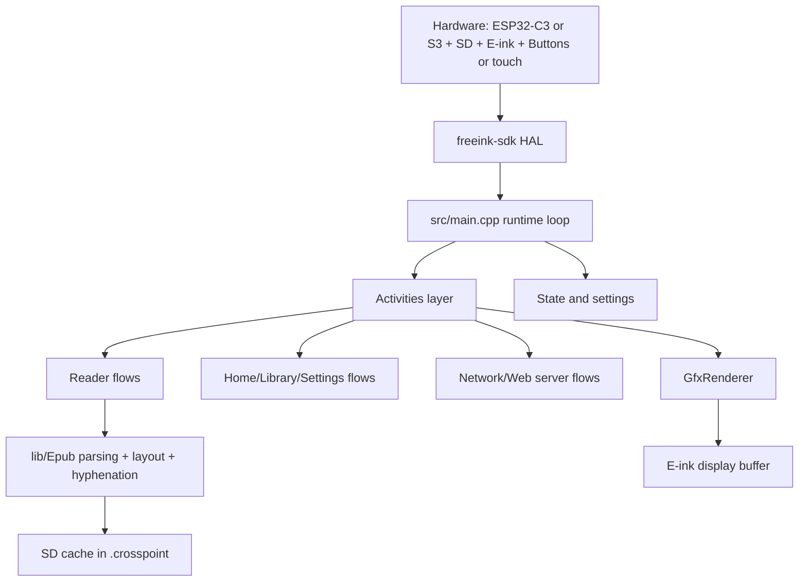
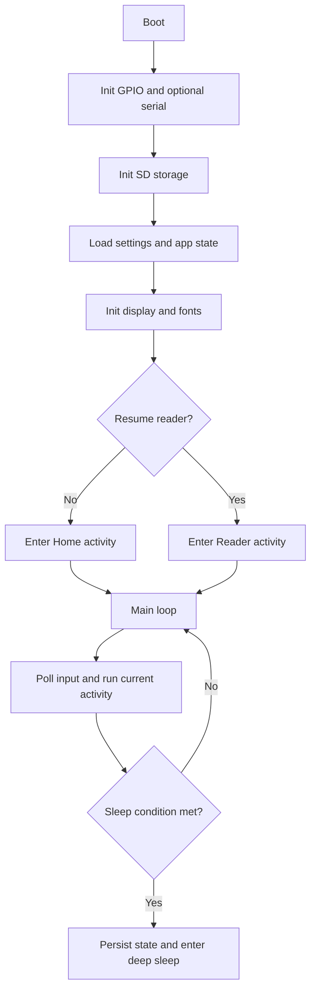
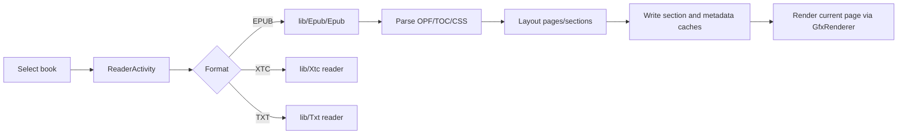
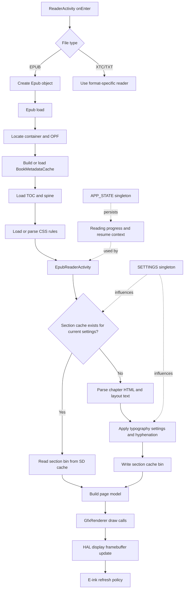

# Architecture Overview

This is firmware for four e-ink readers, built with PlatformIO:

- Xteink X3 and X4 (ESP32-C3, RISC-V). Both are in one binary; the board is detected at runtime.
- Xteink X4 Pro (ESP32-S3).
- LilyGo T5S3 (ESP32-S3, touch panel).

The ESP32-C3 boards are the tightest on RAM and flash, so most memory rules in these docs are written for them. See [Board Support](./board-support.md) for what differs per board. This project is unaffiliated with Xteink.

At a high level, it is firmware that uses an activity-driven application architecture loop with persistent settings/state, SD-card-first caching, and a rendering pipeline optimized for e-ink constraints.

## System at a glance



## Runtime lifecycle

Primary entry point is `src/main.cpp`.



In each loop iteration, the firmware updates input, runs the active activity, handles auto-sleep/power behavior, and applies a short delay policy to balance responsiveness and power.

## Activity model

Activities are screen-level controllers deriving from `src/activities/Activity.h`.
`src/activities/ActivityManager.h` keeps the activity stack; a screen opens another by pushing it and gets the answer back as an `ActivityResult` (`docs/activity-manager.md`).

- `onEnter()` and `onExit()` manage setup/teardown
- `loop()` handles per-frame behavior
- `skipLoopDelay()` and `preventAutoSleep()` are used by long-running flows (for example web server mode)

Top-level activity groups:

- `src/activities/home/`: home, the Library screen (`FileBrowserActivity` with its Books, Recent, New and Authors tabs, and the background build of its book index), book info and bookmarks
- `src/activities/reader/`: EPUB/XTC/TXT/Markdown reading flows, reader menus, KOReader sync screens
- `src/activities/settings/`: settings menus and configuration
- `src/activities/network/`: WiFi selection, AP/STA mode, file transfer server, USB drive and serial transfer
- `src/activities/browser/`: OPDS catalog browser
- `src/activities/weather/`: weather screen and its settings
- `src/activities/util/`: shared dialogs and tools (confirmation, full-screen message, keyboard, BMP viewer, frontlight panel)
- `src/activities/boot_sleep/`: boot and sleep transitions

List screens share three bases in `src/activities/`, all driven by `ListController` (the button scheme is in `docs/design/list-input-harmonization.md`):

- `MenuListActivity`: simple menus
- `UiListActivity`: lists drawn through FreeInkUI; `TabbedUiListActivity` adds tabs
- `ListController`: input handling a list screen holds as a member, not a base class

## Reader and content pipeline

Reader orchestration starts in `src/activities/reader/ReaderActivity.h` and dispatches to format-specific readers.
EPUB processing is implemented in `lib/Epub/`.



Why caching matters:

- RAM is limited, above all on the ESP32-C3, so expensive parsed/layout data is persisted to SD
- repeat opens/page navigation can reuse cached data instead of full reparsing

## Reader internals call graph

This diagram zooms into the EPUB path to show the main control and data flow from activity entry to on-screen draw.



Notes:

- "section cache exists" depends on cache-busting parameters such as font and layout-related settings
- rendering favors reusing precomputed layout data to keep page turns responsive on constrained hardware
- progress/session state is persisted so the reader can reopen at the last position after reboot/sleep

## KOReader sync position mapping

KOReader sync integration is implemented under `lib/KOReaderSync/` and is used by
`src/activities/reader/KOReaderSyncActivity.*`.

Position translation currently follows a dual-path strategy:

- CrossPoint -> KOReader: prefer element-level XPath extracted from the current
  spine XHTML; fallback to chapter-level `DocFragment` path when needed.
- KOReader -> CrossPoint: prefer incoming XPath resolution; fallback to
  percentage-based estimation if XPath is invalid or cannot be resolved.

Detailed algorithm and constraints (including low-memory rationale for ESP32-C3)
are documented in:

- [KOReader Sync XPath Mapping](koreader-sync-xpath-mapping.md)

## State and persistence

Two singletons are central:

- `src/CrossPointSettings.h` (`SETTINGS`): user preferences and behavior flags
- `src/CrossPointState.h` (`APP_STATE`): runtime/session state such as current book, sleep context, and standalone KOReader sync handoff/outcome state

Typical persisted areas on SD:

```text
/.crosspoint/
  epub_<hash>/
    book.bin
    progress.bin
    cover.bmp
    spines/<spine / 32>/*.bin   (per-spine caches, 32 spine items per bucket)
  library/library.bin           (the Library's book index, for the New and Authors tabs)
  settings.json
  state.json
```

For binary cache formats, see `docs/file-formats.md`.

## Networking architecture

Network file transfer is controlled by `src/activities/network/CrossPointWebServerActivity.h` and served by `src/network/CrossPointWebServer.h`.

Modes:

- STA: join existing WiFi network
- AP: create hotspot

Server behavior:

- HTTP server on port 80
- WebSocket upload server on port 81
- file operations backed by SD storage
- activity requests faster loop responsiveness while server is running

Endpoint reference: `docs/webserver-endpoints.md`.

## Build-time generated assets

Some sources are generated and should not be edited manually.

- `scripts/build_html.py` builds the web pages: the setup page into `src/network/html/WebSetupPageHtml.generated.h`, the rest into the SD-card bundle `web-<hash>.bin` in the env's build folder, described to the firmware by `src/network/html/WebBundle.generated.h` (see [the design record](../design/web-assets-on-sd.md))
- `scripts/generate_hyphenation_trie.py` generates hyphenation headers under `lib/Epub/Epub/hyphenation/generated/`

When editing related source assets, regenerate via normal build steps/scripts.

## Key directories

- `src/`: app orchestration, settings/state, and activity implementations
- `src/network/`: web server and OTA/update networking
- `src/components/`: theming and shared UI components
- `lib/Epub/`: EPUB parser, layout, CSS handling, and hyphenation
- `lib/`: supporting libraries (fonts, text, Markdown, OPDS, KOReader sync, the Library's book index in `lib/LibraryIndex/`, filesystem helpers, etc.)
- `freeink-sdk/`: hardware SDK submodule (display, input, storage, battery, board profiles, UI toolkit)
- `docs/`: user and technical documentation; `docs/design/` and `docs/future_work/` are described in the [contributing index](./README.md)

## Embedded constraints that shape design

- constrained RAM (above all on the C3 boards) drives SD-first caching and careful allocations
- e-ink refresh cost drives render/update batching choices
- main loop responsiveness matters for input, power handling, and watchdog safety
- background/network flows must cooperate with sleep and loop timing logic

For deeper design documentation on the memory-critical subsystems:

- [Heap and Data Structure Design](./heap-and-data-structures.md) — allocation rules, ZipFile streaming, CSS index flat array
- [Temporary Memory Increase Logic](./temporary-memory-increase.md) — borrowing vs releasing the secondary buffer, the blocking build, degraded mode, pre-reboot scratch path
- [Section Indexing Workflow](./section-indexing.md) — property hash, cache file structure, the sliceable build and its callers
- [Flash Font Partition](./flash-font-partition.md) — raw partition layout, write/mmap API, kern matrix fast path
- [Font Cache Structures](./font-cache-structures.md) — PerStyle tiers, ownership flags, mini prewarm lifecycle

## Scope guardrails

Before implementing larger ideas, check:

- [SCOPE.md](../../SCOPE.md)
- [GOVERNANCE.md](../../GOVERNANCE.md)
