# Web Interface Guide

Witch Reader has a web interface: while **File Transfer** runs on the reader, any computer, phone or
tablet on the same network can open its pages in a browser. From there you can:

- upload books (and whole folders of them), and organise, rename and delete files on the SD card;
- prepare EPUBs for the reader: shrink their pictures and split overlong chapters;
- correct a book's title, author, series and cover;
- change every setting of the reader, and manage its saved Wi-Fi networks and OPDS catalogs;
- install fonts from the catalog, or convert your own;
- install dictionaries for looking words up;
- see your reading statistics;
- add plugins, and download a report for a bug report.

All of this works without an internet connection, except the few things that fetch something from
the internet (noted below).

> **New in 2.40: setup on the first visit.** The web interface's pages are no longer built into the
> firmware; they live on the SD card. The first time you open the reader's address after installing
> 2.40, and after any later update that changes the pages, a setup page puts them there. See
> [The first visit](#3-the-first-visit-setup).

**Contents**

1. [Start File Transfer on the reader](#1-start-file-transfer-on-the-reader)
2. [Open the web interface](#2-open-the-web-interface)
3. [The first visit: setup](#3-the-first-visit-setup)
4. [Finding your way around](#4-finding-your-way-around)
5. [File Manager](#5-file-manager)
6. [Settings](#6-settings)
7. [Font Manager](#7-font-manager)
8. [Dictionaries](#8-dictionaries)
9. [Reading Stats](#9-reading-stats)
10. [Plugins](#10-plugins)
11. [System Info and Diagnostics](#11-system-info-and-diagnostics)
12. [Other ways to reach the card](#12-other-ways-to-reach-the-card)
13. [Leaving File Transfer](#13-leaving-file-transfer)
14. [Troubleshooting](#14-troubleshooting)
15. [Security](#15-security)

---

## 1. Start File Transfer on the reader

Open **File Transfer** from the Home screen (if your Home screen does not show it, it is under
**More**). The screen offers:

| Entry | What it does |
| ----- | ------------ |
| **Join a Network** | The reader joins your Wi-Fi. Your computer or phone must be on the same network. Use this whenever you can: the reader can then download things it needs, such as the web interface itself and fonts. |
| **Calibre Wireless** | Receive books from Calibre's "Connect to device" (see the [User Guide](../USER_GUIDE.md#361-calibre-wireless-transfers)). |
| **OPDS Browser** | Browse and download from an online catalog on the reader itself. |
| **Create Hotspot** | The reader makes its own Wi-Fi network, **CrossPoint-Reader** (open, no password), for when there is no Wi-Fi around. Join it from your phone or computer. The reader has no internet connection in this mode. |
| **USB Drive** / **USB Transfer** | Copy files over the cable instead (depends on the model; see the [User Guide](../USER_GUIDE.md#36-file-transfer-screen)). |

### Joining a network

The reader first tries the networks it has saved and connects by itself when one is in range.
Otherwise it lists the networks it can see: `*` marks a network with a password, `+` one whose
password is saved. Pick yours, enter the password on the on-screen keyboard, and choose whether to
save it. A saved password is used automatically next time; it is stored scrambled on the SD card and
keeps working if the card moves to another reader.

If a saved password stops working (it was changed on the router, say), the keyboard opens again,
headed **Saved password may be wrong**: type the new one and save it over the old.

Some public networks (hotels, trains) need you to log in through a browser first. The reader then
shows an address to open on another device; once you have logged in there, press **OK**.

### When it is running

The reader shows the address of its web interface, and a QR code for it:

- **On your network:** `http://` followed by the reader's IP address, for example
  `http://192.168.1.42/`, and below it `http://crosspoint.local/`, which works on most computers and
  on iPhones and iPads.
- **In hotspot mode:** first a QR code that joins your phone to the **CrossPoint-Reader** network,
  then one for the address, `http://crosspoint.local/` or `http://192.168.4.1/`.

A bar shows the Wi-Fi signal; a stronger signal makes uploads faster.

## 2. Open the web interface

1. Make sure your computer, phone or tablet is on the **same network** as the reader (in hotspot
   mode: joined to **CrossPoint-Reader**).
2. Open a browser and type the address the reader shows, or scan the QR code with your phone's
   camera. Type `http://`, not `https://`: the reader does not serve encrypted pages.

Any current browser works: Chrome, Edge, Firefox or Safari, on a computer or a phone. A computer is
more comfortable for the File Manager and the optimizer.

## 3. The first visit: setup

The web interface's pages are kept in a small file on the SD card, which must match the firmware.
The first time you open the reader's address, and again after any firmware update that changed the
pages, you see the setup page instead:

- **On your Wi-Fi network** there is nothing to do. The page says *Downloading the web interface…*,
  the reader fetches the matching file from the release on GitHub, and after a few seconds the
  Welcome page opens.
- **In hotspot mode** the reader cannot download anything. The page names the file it needs
  (`web-` followed by a code, ending in `.bin`) and links to the release page where it is attached:

  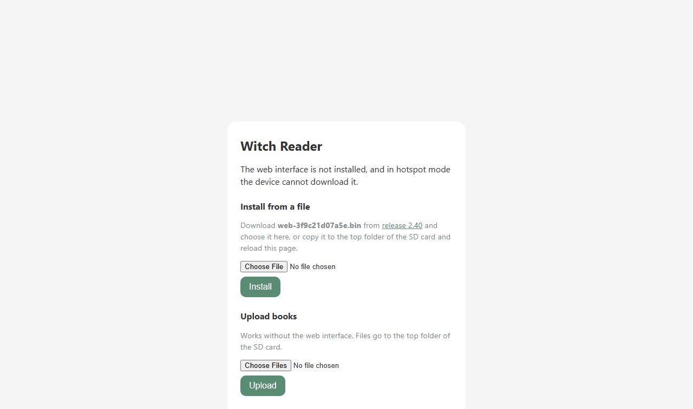

  Download that file beforehand, on a device with internet, then either choose it under **Install
  from a file** and click **Install**, or copy it to the top folder of the SD card and reload the
  page. Only the exact file for your firmware is accepted.

The setup page can also **upload books** by itself (they go to the top folder of the card), so you
can always add books, even before the web interface is installed. It stays available at
`http://<reader address>/setup`.

## 4. Finding your way around

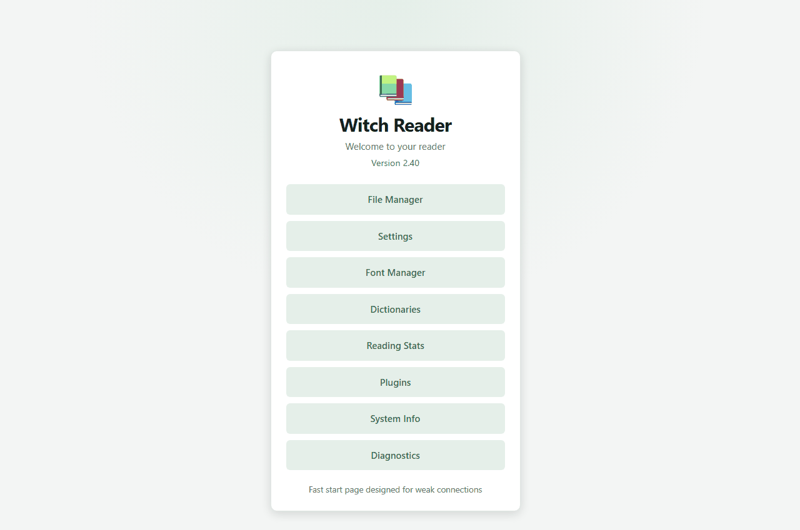

The Welcome page has a button for each part of the web interface. Every other page shows the same
entries along its top: **File Manager**, **Settings**, **Font Manager**, **Dictionaries**, **Reading
Stats**, **Plugins**, **System Info** and **Diagnostics**. On a phone this bar scrolls sideways.

The round button at the right end of the bar switches between automatic colours (following your
computer's or phone's light or dark setting), light and dark. Your browser remembers the choice.

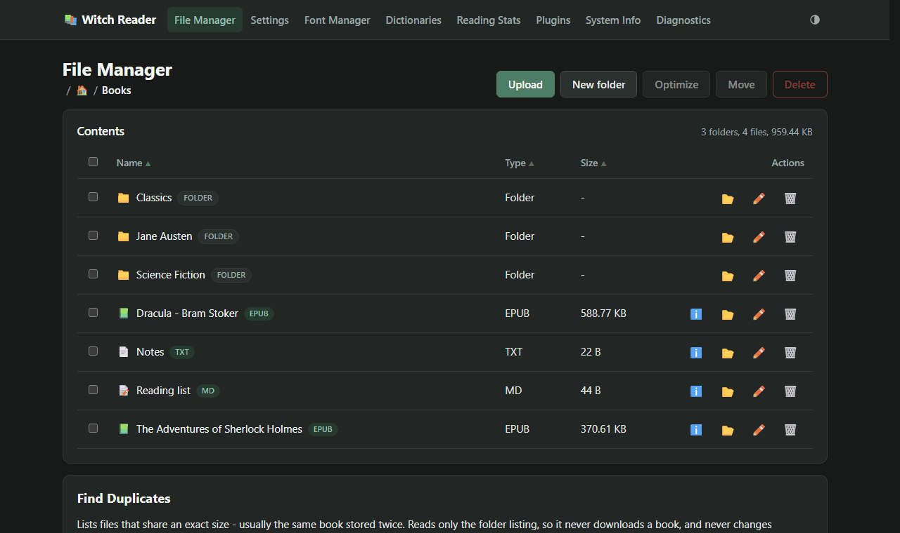

## 5. File Manager

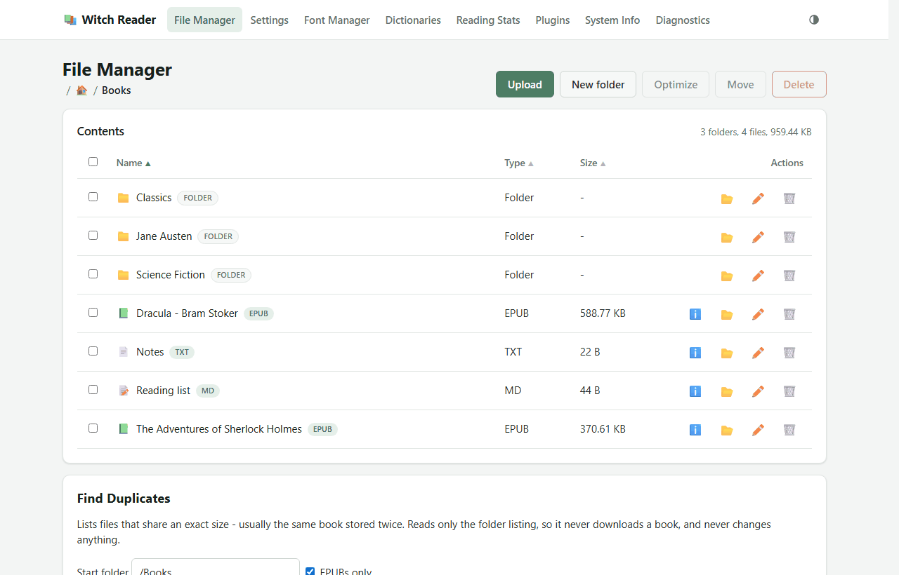

The File Manager shows one folder of the SD card at a time. The line under the title shows where you
are; click a part of it to go back up, or the house for the top of the card. Click a folder to open
it. Click a column heading to sort by name, type or size, and click it again to reverse the order.

Each book has a label with its format (EPUB, XTC, TXT, MD). At the right of each row:

| Button | Does |
| ------ | ---- |
| ℹ️ **Details** (books only) | Edit the book's title, author, series and cover (below) |
| 📂 **Move** | Move it to another folder |
| ✏️ **Rename** | Rename it |
| 🗑️ **Delete** | Delete it, after asking |

Tick the boxes in front of several items (or the box in the header for all of them) to **Move**,
**Delete** or **Optimize** them together with the buttons at the top.

Moving or renaming a book here keeps its reading position, bookmarks and reading stats. A folder can
only be deleted when it is empty, and deleting cannot be undone.

Files and folders whose names start with a dot, such as the reader's own `.crosspoint` folder, are
hidden unless **Show Hidden Files** is on in the reader's settings (**System**). Even then, the files
holding your saved Wi-Fi, OPDS and KOReader passwords can't be downloaded or overwritten here. To change
a saved password, use [Settings](#6-settings).

### Uploading

Click **Upload**, choose one or more files, and click **Upload** in the dialog: the files go into the
folder you are looking at. You can also **drag files or whole folders** from your computer onto the
page; a dropped folder is created on the card with everything in it. A bar shows the progress; the
list refreshes when the last file has arrived. If a file fails, a banner lists it with a **Retry**
button.

When a file of the same name is already in the folder, you are asked what to do:

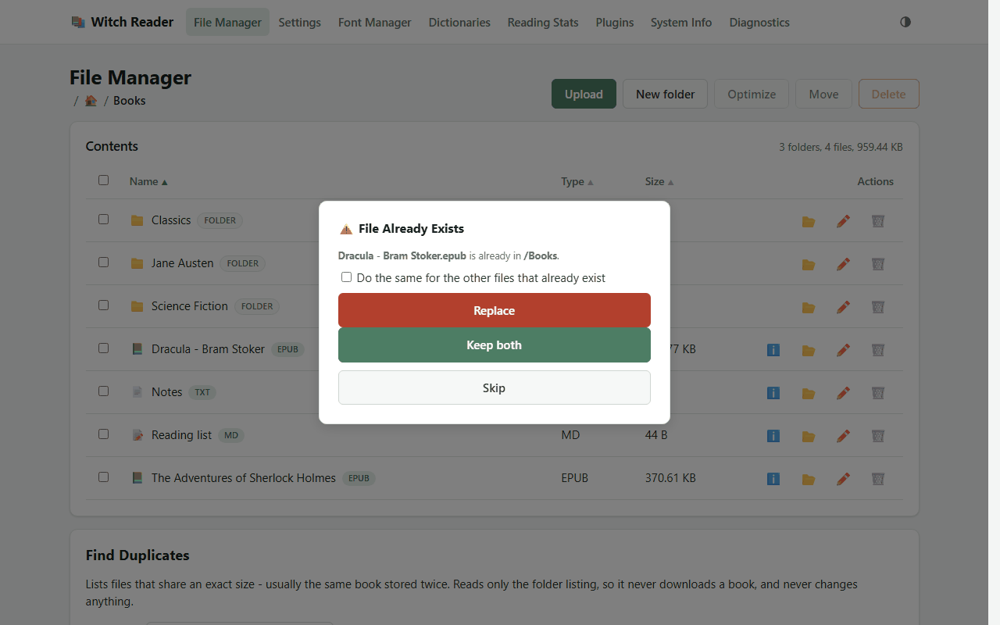

- **Replace** overwrites the file on the card;
- **Keep both** saves the upload as "name (2)";
- **Skip** leaves this file out.

Tick **Do the same for the other files that already exist** to answer once for the whole upload.

### Optimizing EPUBs

Many EPUBs carry pictures far larger than the reader's screen, and some have chapters so long that
the reader is slow to open them and can run short of memory laying them out. Tick **Optimize EPUB** in
the upload dialog and your browser prepares each EPUB before it is sent. Click **Advanced Mode** to see
the options:

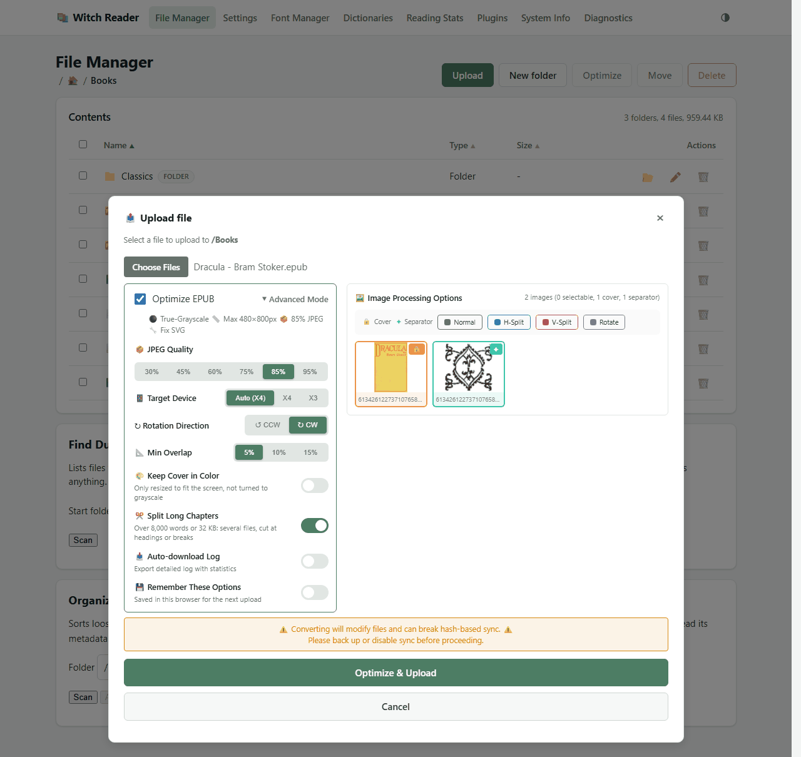

- **Pictures** are converted to grayscale JPEGs at the size of the reader's screen (**Target Device**;
  **Auto** uses the reader you are connected to), at the **JPEG Quality** you choose. Very tall
  pictures are turned or split into parts; the panel on the right shows the book's pictures, and you
  can set each one to Normal, split across or down, or rotate it. **Keep Cover in Color** leaves the
  cover in colour and only resizes it.
- **Split Long Chapters** (on by default) cuts a chapter of more than 8,000 words or 32 KB into
  several parts, at a heading or scene break where it can, and fixes every link and table-of-contents
  entry to match.
- Empty chapter stubs, comments and invisible characters are removed. Books protected with DRM are
  refused rather than broken.
- **Remember These Options** keeps your choices in this browser for next time. **Auto-download Log**
  saves a report of what was changed.

All the work happens in your browser, so a large book takes a moment on a slow phone.

> **KOReader sync and optimized books.** Optimizing changes the book file. KOReader sync can match a
> book by its contents (KOReader's default) or by its file name (Witch Reader's default). Matched by
> contents, an optimized copy no longer counts as the same book as the original on another device.
> Matched by file name it does, but if chapters were split or stubs removed, the chapters are numbered
> differently, so a synced position can land in the wrong chapter. If you sync with KOReader, read the
> **same file** on every device (copy the optimized book to your other devices too), or turn off
> **Split Long Chapters**.

#### Books already on the card

Tick the EPUBs in the list and click **Optimize** at the top:

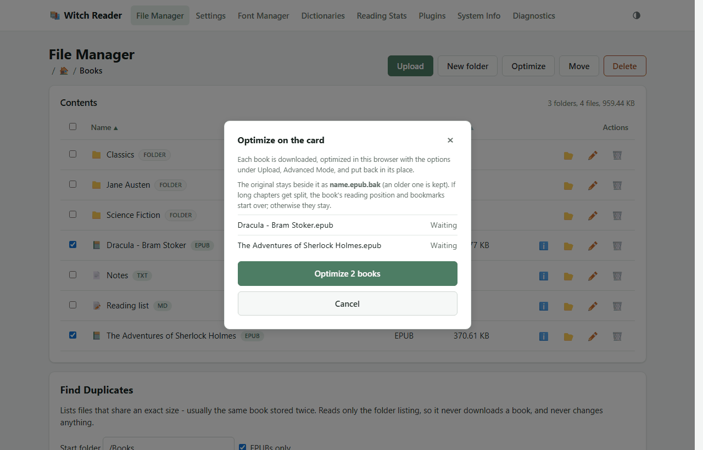

Each book is downloaded to your browser, optimized with the options from the upload dialog, and put
back in its place. The original is kept beside it as `name.epub.bak` (if there already is one, that
older copy stays). When no chapter had to be split or removed, the book keeps its reading position
and bookmarks; otherwise it starts over, like a newly uploaded book. Reading stats always stay.

### Book details

Click ℹ️ beside a book to correct what the reader shows for it:

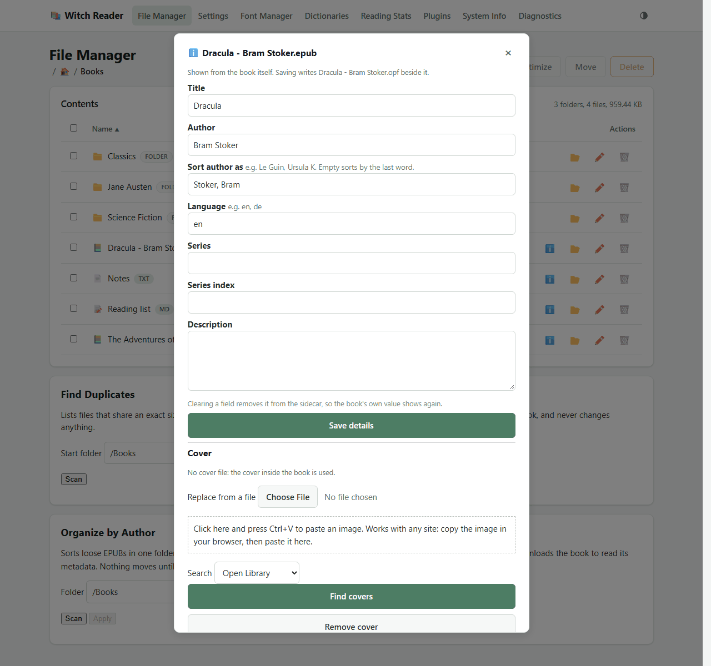

- **Title**, **Author**, **Sort author as** (how the author is filed in the Library's **Authors** tab,
  for example "Le Guin, Ursula K."; left empty, the last word of the name is used), **Language**,
  **Series** and its number, and **Description**.
- **Cover:** choose a picture file, or click the box and paste a picture copied in your browser
  (Ctrl+V, or Cmd+V on a Mac), or search **Open Library**, **Goodreads** or **Google Books** and
  pick one of the covers found. Searching needs the reader to be online. **Remove cover** goes back to
  the cover inside the book.
- For an EPUB, **Convert its fonts** opens the Font Manager with the fonts the book embeds (see
  [Font Manager](#7-font-manager)).

The book file itself is never changed: the details are saved in a `.opf` file beside the book (and
the cover in a picture file beside it), which the reader prefers to the book's own. Clear a field to
go back to the book's own value. This works for EPUB, XTC, TXT and Markdown books.

### Creating folders

Click **New folder**, type a name and confirm. Names cannot contain `" * : < > ? / \ |`.

### Plugin cards

Installed plugins can add cards below the file list, such as **Find Duplicates** and **Organize by
Author**. See [Plugins](#10-plugins).

## 6. Settings

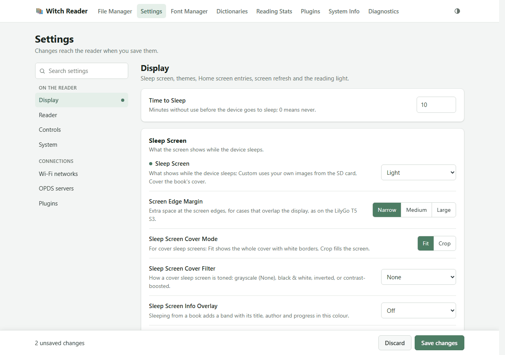

The Settings page has the same settings as the reader's Settings screens, with a line explaining
each. Pick a category on the left (on a phone: along the top): **Display**, **Reader**, **Controls**
and **System**. Settings that only make sense on some models (the reading light, the touch screen)
appear only for a reader that has them.

Changes are not sent straight away. A bar at the bottom counts them, and changed settings and their
categories are marked with a dot; click **Save changes** to send them to the reader, or **Discard**.
The font size lists show the sizes the chosen font offers; after you change the font and save, the
list follows.

The **search box** finds a setting in any category:

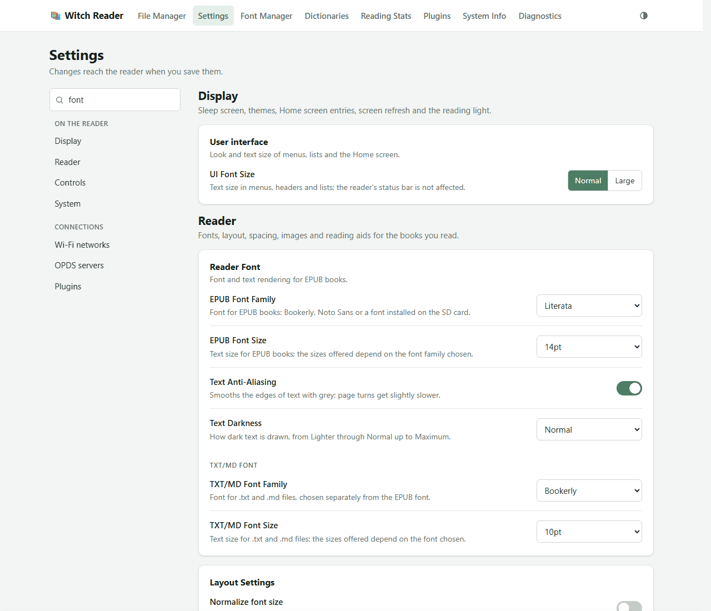

### Wi-Fi networks and OPDS servers

Under **Connections**, **Wi-Fi networks** lists the networks the reader joins by itself, and **OPDS
servers** the catalogs it knows. You can add one, change its name or address, or forget it; each
entry is saved on its own.

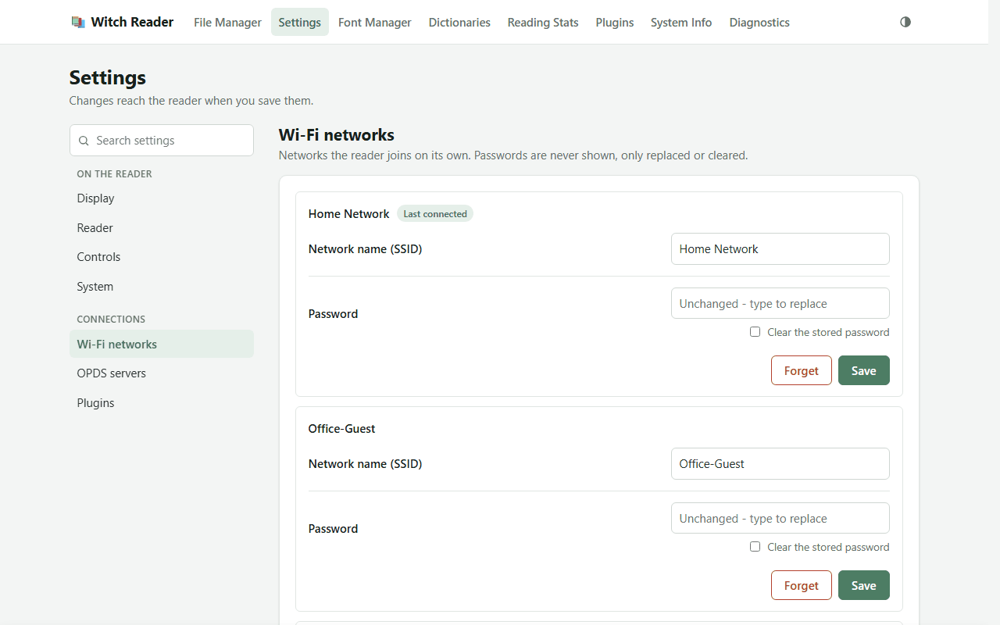

A saved password is never shown, so you can't read it or correct a typo in it: type the whole password
again to replace it, leave the field empty to keep the stored one, or tick **Clear the stored
password**.

**Plugins** under Connections holds the cards of plugins that add themselves to the Settings page.

## 7. Font Manager

Fonts for reading live on the SD card. The menu on the left switches between four parts:

**Installed fonts** lists the font families on the card, with their sizes, and deletes the ones you no
longer use.

**Download fonts** lists the families in the online catalog. **Download** installs one, **Update**
appears when a newer version is available (the number beside the menu entry counts them), and
**Download all updates** fetches them all. The reader downloads the files itself, so it must be
online.

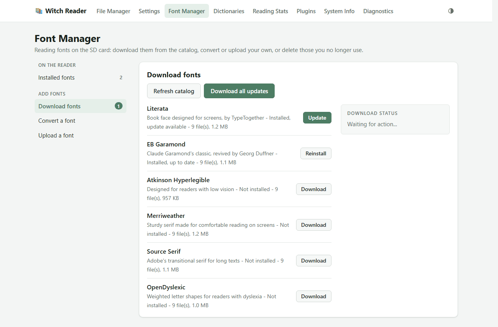

**Convert a font** makes a family from your own TrueType or OpenType files (`.ttf`, `.otf`, `.woff`),
in your browser, without internet, so it also works in hotspot mode:

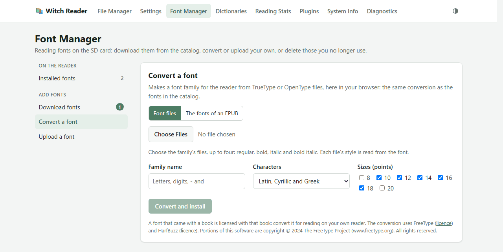

1. Choose the family's files: up to four, for regular, bold, italic and bold italic. Each file's
   style is read from the font itself; a regular one is needed. Variable fonts (one file for every
   weight) cannot be converted; use the family's separate files.
2. Check the **Family name** (letters, digits, `-` and `_`), the **Characters** to include, and the
   **Sizes**.
3. Click **Convert and install**. Then choose the font on the reader as your reading font.

The conversion is the same one the catalog's fonts are made with, so a converted font looks just as
good. **The fonts of an EPUB** takes the fonts a book embeds instead: choose the book from your
computer (or use **Convert its fonts** in the File Manager's Details). Fonts protected with DRM can't
be converted. A font that came with a book is licensed with that book: convert it for reading on your
own reader only.

**Upload a font** installs `.cpfont` files you already have.

## 8. Dictionaries

The reader looks words up in StarDict dictionaries in the card's `/dictionaries` folder. This page
installs, checks and removes them:

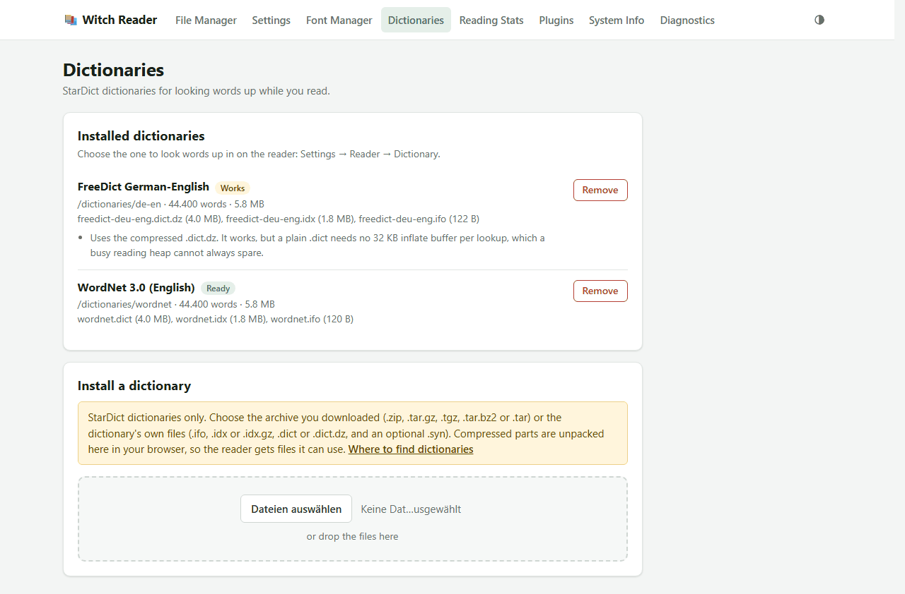

To install one, choose the archive you downloaded (`.zip`, `.tar.gz`, `.tgz`, `.tar.bz2` or `.tar`),
or the dictionary's own files (`.ifo`, `.idx` or `.idx.gz`, `.dict` or `.dict.dz`, and optionally
`.syn`), or drop them on the page. Your browser unpacks what the reader can't read compressed, checks
the files, and uploads them into a folder of their own. An archive holding several dictionaries
becomes one folder each.

Each installed dictionary is marked **Ready**, **Works** (usable, with a note on what would make it
better) or **Not usable** (with the reason). Choose the dictionary you want on the reader, under
**Settings → Reader → Dictionary**. See [Dictionary](./dictionary.md) for where to find dictionaries.

## 9. Reading Stats

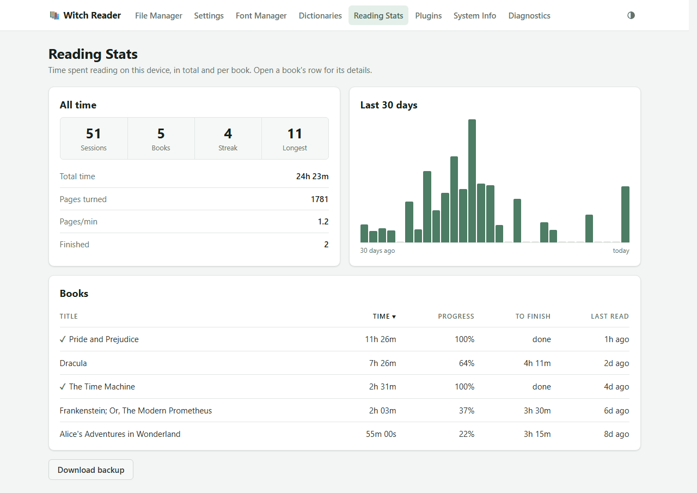

The same numbers as the Reading Stats screens on the reader: your total reading time, sessions,
streaks and pages, a chart of the last 30 days, and a list of the books you have read, with time,
progress and an estimate of the time left. Click a book for its details, where **Remove from stats**
takes it out of the totals.

**Download backup** saves your whole history as `reading-stats.json`. Keep it before you go back to an
older firmware.

## 10. Plugins

Plugins add tools to the File Manager and Settings pages. They run in your browser, not on the reader.

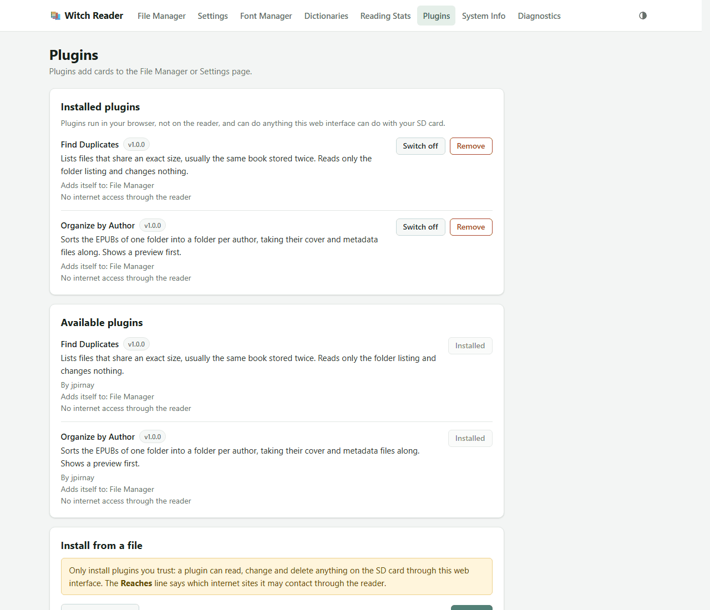

- **Installed plugins** lists what is on the card. **Switch off** keeps a plugin but stops loading
  it; **Remove** deletes it.
- **Available plugins** is the catalog of this project's plugins. Your browser reads it from GitHub,
  so it needs internet (in hotspot mode, use a file instead). Click **Install** on one.
- **Install from a file** takes a plugin as a `.zip` file.

Each plugin says which page it adds itself to and which internet sites it may reach through the reader
(**Reaches**). Only install plugins you trust: a plugin can read, change and delete anything on the
card that this web interface can. For writing your own, see [SD-card web plugins](./sd-plugins.md).

## 11. System Info and Diagnostics

**System Info** shows the firmware version, the model, the network and IP address, the battery, the
memory, and (after **Load SD info**, which takes a moment on a large card) the card's size and free
space.

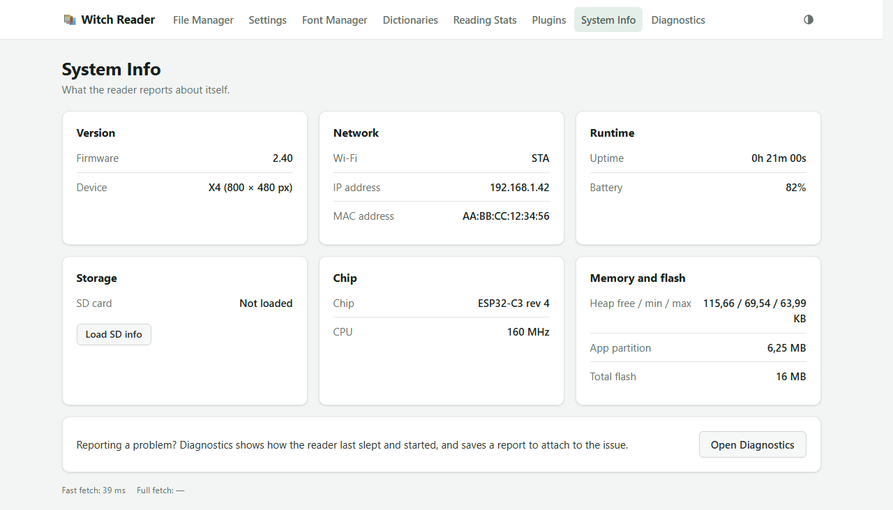

**Diagnostics** is for bug reports. It shows how the reader last went to sleep and started up, and the
history of the last sleeps and starts, the same as **Settings → System → Boot Diagnostics** on the
reader but in plain words. **Download report** saves all of it, with the firmware version and device
status, as one file to attach to an issue. The report leaves out the IP and MAC address and holds no
passwords.

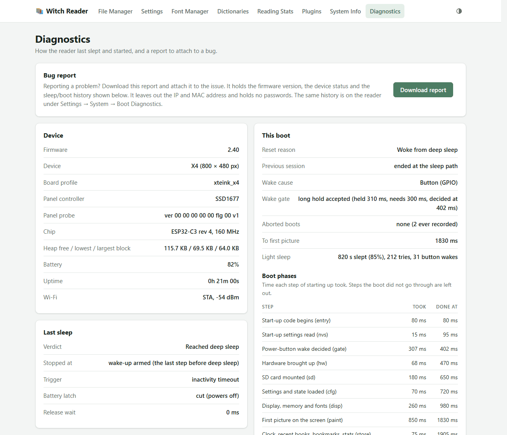

## 12. Other ways to reach the card

- **WebDAV.** While File Transfer runs, the card is also served over WebDAV at the same address, so
  you can connect to `http://<reader address>/` as a network drive in Windows Explorer, macOS Finder or
  a Linux file manager, and copy files without the web page. Folders must be empty to be deleted, and
  nothing inside a folder whose name starts with a dot can be changed this way.
- **Calibre.** Calibre's "Connect to device" works through **Calibre Wireless** on the File Transfer
  screen.
- **Scripts.** Every page uses a small HTTP API that `curl` or a script can use too; see
  [Webserver Endpoints](./webserver-endpoints.md).

## 13. Leaving File Transfer

Press **Back** on the reader (or tap **Exit** on a touch screen). The web server stops, Wi-Fi is
switched off to save battery, and the reader restarts quietly into the Home screen. Books you uploaded
are in the Library's **Books** tab straight away; **New** and **Authors** pick them up the next time
you open those tabs.

**Back** also works in the middle of an upload from the File Manager or the Font Manager: the upload
is cancelled and the part that arrived is deleted, so send that file again later. A file being copied
over WebDAV finishes arriving first.

## 14. Troubleshooting

**The page does not open.**
- Check that your computer or phone is on the same network as the reader (in hotspot mode, joined
  to **CrossPoint-Reader**; some phones drop a network without internet: allow it to stay connected).
- Type the address with `http://`, not `https://`. If `crosspoint.local` does not work (common on
  Android and on some Windows setups), use the IP address the reader shows.
- Guest or office networks often keep devices from seeing each other. Use your home network, or the
  hotspot.

**The setup page keeps coming back.** After every firmware update that changed the pages, the setup
runs once more; this is normal. In hotspot mode it can't download: use the `web-….bin` file from the
release page (see [The first visit](#3-the-first-visit-setup)). If it fails on your Wi-Fi network,
the download from GitHub did not work: **Try the download again**, or use the file.

**An upload fails.** Check the free space on the card (**System Info → Load SD info**). Uploads are
faster and more reliable with a strong Wi-Fi signal; the reader's screen shows it. A failed file can
be sent again with **Retry**.

**Something that needs the internet does not work** (font downloads, cover search, the plugin
catalog). The reader must be on a network with internet access for font downloads and cover search;
for the plugin catalog, your browser must be. Neither works in hotspot mode. Font conversion and the
EPUB optimizer work without internet.

**The reader seems slow or restarts while the web interface is open.** It has far less memory than a
computer. Avoid having the web interface open in several browser tabs at once, and wait for one large
job (an upload, a font install) to finish before starting the next.

## 15. Security

- The web interface has **no password**: anyone on the same network can use it while File Transfer
  runs. Use it on networks you trust, or in hotspot mode.
- It runs only while File Transfer is open on the reader, and stops when you leave.
- Pages are served over plain HTTP (port 80); fast uploads use port 81.
- The files that hold your saved Wi-Fi, OPDS and KOReader passwords can't be downloaded or overwritten
  through the File Manager or WebDAV. The Settings page never shows a saved password: you can replace
  it with a new one or clear it, but you can't read it or correct it in place.
- The reader joins 2.4 GHz Wi-Fi networks only.

---

Related: [User Guide](../USER_GUIDE.md) · [Webserver Endpoints](./webserver-endpoints.md) ·
[Dictionary](./dictionary.md) · [SD-card web plugins](./sd-plugins.md) ·
[Troubleshooting](./troubleshooting.md)
