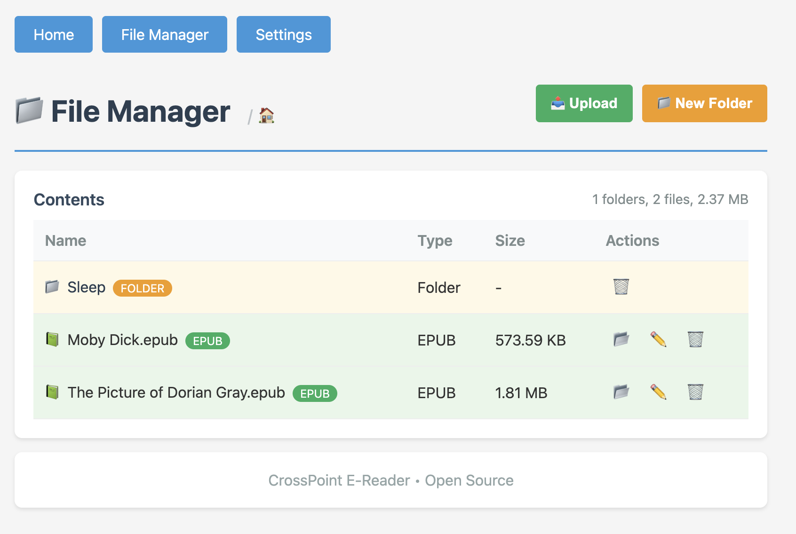
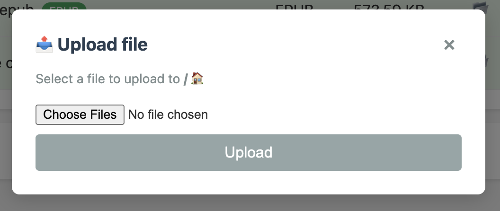

# Web Server Guide

This guide explains how to connect your CrossPoint Reader to WiFi and use the built-in web server to upload files from your computer or phone.

## Overview

CrossPoint Reader includes a built-in web server that allows you to:

- Upload files wirelessly from any device on the same WiFi network
- Browse and manage files on your device's SD card
- Create folders to organize your library
- Rename, move and delete files and folders
- Change device settings, manage fonts, and view your reading stats
- Mount the card as a WebDAV drive (see [Other ways in](#other-ways-in))

## Prerequisites

- Your CrossPoint Reader device
- A WiFi network
- A computer, phone, or tablet connected to the **same WiFi network**

---

## Step 1: Starting the Web Server

1. On the Home screen, open **File Transfer**. If your Home screen does not show it, look under **More**.
2. Choose how to connect:
   - **Join a Network**: the device joins your WiFi (Step 2). Your computer or phone must be on the same network.
   - **Create Hotspot**: the device makes its own WiFi network, **CrossPoint-Reader**. Join it from your computer or phone; the screen shows the address to open.

The other entries on that screen (Calibre wireless, USB) are described in the [User Guide](../USER_GUIDE.md#36-file-transfer-screen).

---

## Step 2: Connecting to WiFi

### Viewing Available Networks

Once the scan completes, you'll see a list of available WiFi networks with the following indicators:

- **Signal strength bars** (`||||`, `|||`, `||`, `|`) - Shows connection quality
- **`*` symbol** - Indicates the network is password-protected (encrypted)
- **`+` symbol** - Indicates you have previously saved credentials for this network

### Selecting a Network

1. Use the **Left/Right** (or **Volume Up/Down**) buttons to navigate through the network list
2. Press **Confirm** to select the highlighted network

### Entering Password (for encrypted networks)

If the network requires a password:

1. An on-screen keyboard will appear
2. Use the navigation buttons to select characters
3. Press **Confirm** to enter each character
4. When complete, select the **Done** option on the keyboard

**Note:** If you've previously connected to this network, the saved password will be used automatically.

If the network turns the saved password down (it has been changed on the router, say), the keyboard
appears again headed **Saved password may be wrong**. Type the current password; once it connects you
are asked whether to save it over the old one. **Back** returns to the list and keeps the saved one.
When this happens on the automatic connect, the reader first tries your other saved networks in range
and asks only if none of them works. Picking that network again in the same session goes straight to
the keyboard.

Saved passwords travel with the SD card: a card moved from another reader keeps working.

### Connection Process

The device will display "Connecting..." while establishing the connection. This typically takes 5-10 seconds.

### Saving Credentials

If this is a new network, you'll be prompted to save the password:

- Select **Yes** to save credentials for automatic connection next time (NOTE: These are stored in plaintext on the device's SD card. Do not use this for sensitive networks.)
- Select **No** to connect without saving

---

## Step 3: Connection Success

Once connected, the screen will display:

- **Network name** (SSID)
- **IP Address** (e.g., `192.168.1.102`)
- **Web server URL** (e.g., `http://192.168.1.102/`)

**Important:** Make note of the IP address - you'll need this to access the web interface from your computer or phone.

---

## Step 4: Accessing the Web Interface

### From a Computer

1. Ensure your computer is connected to the **same WiFi network** as your CrossPoint Reader
2. Open any web browser (Chrome is recommended)
3. Type the IP address shown on your device into the browser's address bar
   - Example: `http://192.168.1.102/`
4. Press Enter

### From a Phone or Tablet

1. Ensure your phone/tablet is connected to the **same WiFi network** as your CrossPoint Reader
2. Open your mobile browser (Safari, Chrome, etc.)
3. Type the IP address into the address bar
   - Example: `http://192.168.1.102/`
4. Tap Go

---

## Step 5: Using the Web Interface

### The First Visit

The web interface's pages are kept on the SD card rather than in the firmware.
The first time you open the device's address, and after a firmware update that
changed them, a setup page installs them:

- **On your WiFi network** it downloads them from the release by itself and then
  opens the Welcome page. This takes a few seconds.
- **In hotspot mode** the device has no internet connection. Download the
  `web-….bin` file the setup page names from the release page beforehand, and
  choose it under **Install from a file**. You can also copy that file to the
  top folder of the SD card and reload the page.

The setup page can upload books on its own too, so a missing web interface never
stops you adding books. It stays available at `http://<device-ip>/setup`.

### Welcome Page

The page you land on at `http://<device-ip>/` has one link per page, and every other page shows the
same links along its top:

- **File Manager**: browse and manage the SD card (below)
- **Settings**: device settings and saved networks (below)
- **Font Manager**: install and remove SD-card fonts (below)
- **Dictionaries**: install and remove dictionaries for word lookup (below)
- **Reading Stats**: your reading history (below)
- **Plugins**: install, switch off and remove web-interface plugins (below)
- **System Info**: device status and version, WiFi state, IP address, free memory and SD card usage
- **Diagnostics**: how the device last slept and started, and a report for bug reports (below)

### File Manager

Click **File Manager** to access file management features.

#### Browsing Files

- The file manager displays all files and folders on your SD card
- **Folders** are highlighted in yellow and indicated with a 📁 icon
- **EPUB Files** are highlighted in green and indicated with a 📗 icon
- **All Other Files** are not highlighted and indicated with a 📄 icon
- Click on a folder name to navigate into it
- Use the breadcrumb navigation at the top to go back to parent folders
- Files and folders whose names start with `.` are hidden unless **Show Hidden Files** is on
  in the device settings. Even then, a file or folder whose own name starts with `.` cannot be
  downloaded, renamed, moved or deleted from here; only what is inside such a folder can.
- The files holding saved WiFi, OPDS and KOReader passwords, and the `System Volume Information`
  and `XTCache` folders, are never served. See
  [Protected paths](./webserver-endpoints.md#protected-paths).

#### Uploading Files

1. Click the **📤 Upload** button in the top-right corner
2. Click **Choose File** and select a file from your device
3. Click **Upload**
4. A progress bar will show the upload status
5. The page will automatically refresh when the upload is complete

#### Creating Folders

1. Click the **📁 New Folder** button in the top-right corner
2. Enter a folder name (must not contain characters \" * : < > ? / \\ | and must not be . or ..)
3. Click **Create Folder**

This is useful for organizing your library by genre, author, series or file type.

#### Deleting Files and Folders

1. Click the **🗑️** (trash) icon next to any file or folder
2. Confirm the deletion in the popup dialog
3. Click **Delete** to permanently remove the item

**Warning:** Deletion is permanent and cannot be undone!

**Note:** Folders must be empty before they can be deleted.

#### Moving Files

1. Click the **📂** (folder) icon next to any file
2. Enter a folder name or select one from the dropdown
3. Click **Move** to relocate the file

**Note:** Typing in a nonexistent folder name will result in the following error: "Failed to move: Destination not found"

#### Renaming Files

1. Click the **✏️** (pencil) icon next to any file
2. Enter a file name (must not contain characters \" * : < > ? / \\ | and must not be . or ..)
3. Click **Rename** to permanently rename the file

---

### Settings

The Settings page lists the same settings as the Settings screens on the device, grouped by
category. Change a value and save. The font size lists show the sizes the selected font family
offers, so after you change a family and save, the page reloads them. Two cards at the end manage
the **Wi-Fi Networks** and **OPDS Servers** the device remembers. Saved passwords are never shown
back; leave the password field empty when editing to keep the stored one. See
[Web Settings](../USER_GUIDE.md#376-web-settings-wifi--opds) in the User Guide.

### Reading Stats

The Stats page shows your reading time, streaks and a list of books with per-book figures, the same
numbers as the Reading Stats screens on the device. From it you can **export** the history as a
`reading-stats.json` backup and **remove** a book from the stats.

### Font Manager

The Fonts page lists the font families installed on the SD card and the families available online.
You can install or update one or all of them (the device downloads them itself, so it needs internet
access), upload a `.cpfont` file from your computer, or delete a family.

### Dictionaries

The Dictionaries page lists the StarDict dictionaries in `/dictionaries`, says whether the reader can
use each one and what is wrong if not, and removes them. To install one, choose the archive you
downloaded (`.zip`, `.tar.gz`, `.tgz`, `.tar.bz2` or `.tar`) or the dictionary's own files: your
browser unpacks what the reader cannot read compressed, checks the files and uploads them into a
folder of their own. You still choose the active dictionary on the device. See
[Dictionary](./dictionary.md#install-from-the-web-interface).

### Diagnostics

The Diagnostics page shows the device status and the sleep and boot history that the device shows
under **Settings → System → Boot Diagnostics**, in plain words. **Download report** saves both, with
the firmware version, as one file to attach to a bug report. It leaves out the IP and MAC address.

### Plugins

Small add-ons kept on the SD card can add cards to the File Manager and Settings pages. The
**Plugins** page lists the installed ones and lets you switch each off or remove it, installs new
ones from the catalog of this project's plugins (your browser needs an internet connection for
that) or from a `.zip` file, and shows which internet sites each plugin may contact through the
reader. Only install plugins you trust: a plugin can do anything this web interface can do with your
SD card. See [SD-card web plugins](./sd-plugins.md).

### Other ways in

- **WebDAV.** The card is also served over WebDAV at the same address, so you can mount
  `http://<device-ip>/` as a network drive in your file manager and copy files without the web page.
  Folders must be empty to delete.
- **curl and scripts.** See the next section.

---

## Command Line File Management

For power users, you can manage files directly from your terminal using `curl` while File Transfer is running. Detailed documentation can be found [here](./webserver-endpoints.md). 

## Security Notes

- The web server runs on port 80 (standard HTTP)
- **No authentication is required** - anyone on the same network can access the interface
- The web server is only accessible while the File Transfer screen shows it is running
- The web server automatically stops when you leave the File Transfer screen
- For security, only use on trusted private networks

---

## Technical Details

- **Supported WiFi:** 2.4GHz networks (802.11 b/g/n)
- **Web Server Port:** 80 (HTTP); fast uploads from the File Manager use a WebSocket on port 81
- **Maximum Upload Size:** Limited by available SD card space
- **Browser Compatibility:** All modern browsers (Chrome, Firefox, Safari, Edge)

---

## Tips and Best Practices

1. **Organize with folders** - Create folders before uploading to keep your library organized
2. **Check signal strength** - Stronger signals (`|||` or `||||`) provide faster, more reliable uploads
3. **Upload multiple files** - You can select and upload multiple files at once; the manager will queue them and refresh when the batch is finished
4. **Use descriptive names** - Name your folders clearly (e.g., "SciFi", "Mystery", "Non-Fiction")
5. **Keep credentials saved** - Save your WiFi password for quick reconnection in the future
6. **Exit when done** - Press **Back** to leave the File Transfer screen and save battery

---

## Stopping the Web Server

When you are finished:

1. Press the **Back** button on your CrossPoint Reader
2. The web server will automatically stop
3. WiFi will disconnect to conserve battery
4. The device restarts quietly and opens the Home screen

**Back** also works while an upload is still running, from the File Manager or the Font Manager:
the upload is abandoned, so send that file again later. A file being copied over WebDAV finishes
arriving before the device leaves.

Your uploaded books show up in the Library's **Books** tab straight away. **New** and **Authors**
pick them up the next time you open one of those tabs, when the Library rebuilds its index.

---

## Related Documentation

- [User Guide](../USER_GUIDE.md) - General device operation
- [Troubleshooting](./troubleshooting.md) - Troubleshooting
- [README](../README.md) - Project overview and features
